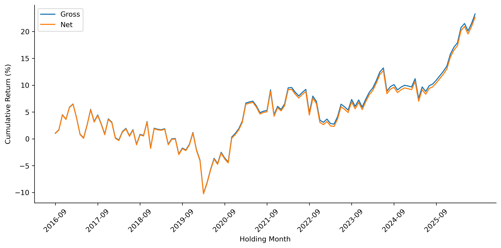
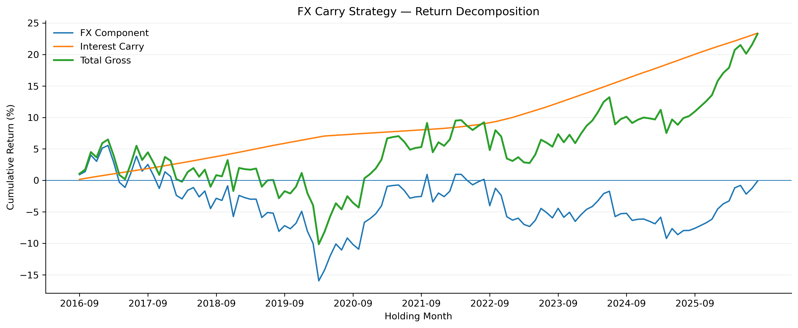

# FX Carry Trade

This repository contains a systematic empirical study of the FX carry
trade using eight major currencies over August 2016 to August 2026.

## Research Questions

### Primary

Does systematically buying high-interest-rate currencies and shorting
low-interest-rate currencies produce a statistically significant and
economically meaningful excess return after FX movements, carry, and
transaction costs?

### Secondary

1.  Do observed one-month FX forward rates deviate from CIP-implied
    forward rates?
2.  Are CIP deviations related to the forward-carry signal?
3.  Does forward carry predict subsequent FX returns?
4.  How robust is the strategy to transaction costs and portfolio
    concentration?

## Currency Universe

EUR, JPY, GBP, CHF, NOK, AUD, NZD, and CAD, with USD as the reference
currency.

## Methodology

### FX Returns

For direct USD-per-foreign quotations:

$$
R_t = \frac{S_t}{S_{t-1}}-1
$$

For inverse quotations:

$$
R_t = \frac{S_{t-1}}{S_t}-1
$$

This makes positive returns consistently represent foreign-currency
appreciation against USD.

### Interest Differential

$$
d_{i,t}=r_{i,t}-r_{USD,t}
$$

### Forward Carry

The one-month forward premium/discount is converted into a
currency-level carry signal, with larger forward discounts receiving
higher carry rankings.

### Portfolio

At each formation month:

-   Buy the three highest-carry currencies.
-   Short the three lowest-carry currencies.
-   Equal-weight currencies within each side.
-   Hold the resulting portfolio during the following month.

The one-month formation-to-holding lag prevents look-ahead bias.

### Transaction Costs

Portfolio turnover is:

$$
Turnover_t=\frac{1}{2}\sum_i |w_{i,t}-w_{i,t-1}|
$$

The baseline transaction-cost assumption is 5 bps per unit of one-way
turnover. Robustness is tested at 2.5, 5, and 10 bps.

## Key Results

  Metric                         Result
  --------------------------- ---------
  Cumulative net return          22.67%
  Annualized return               2.29%
  Annualized volatility           6.59%
  Sharpe ratio                     0.34
  Maximum drawdown              -15.67%
  Best month                      4.82%
  Worst month                    -6.43%
  Positive months                 60.0%
  Mean monthly FX return         0.017%
  Mean monthly carry return      0.175%
  Mean monthly gross return      0.193%
  Mean monthly net return        0.189%
  Total transaction costs        0.483%

## Strategy Performance


## Return Decomposition


## Statistical Findings

The mean monthly net return is positive but is not statistically
significant.

-   Standard t-test: t = 1.09, p = 0.280
-   Newey-West/HAC test: t = 1.31, p = 0.189
-   Bootstrap 95% confidence interval: -0.154% to 0.520%

UIP is rejected at the 5% level for 7 of the 8 currencies.

Mean CIP deviations are statistically significant for all 8 currencies.

CIP deviations are significantly related to the forward-carry signal for
all 8 currencies, although the direction differs across quotation
conventions.

The correctly aligned forward-carry prediction tests find no
statistically significant relationship between formation-month forward
carry and the following month's standalone FX return.

## Return Decomposition

Approximately 91.0% of the average gross return comes from interest-rate
carry and 9.0% from FX movements.

## Risk

The strategy has meaningful downside risk. Maximum drawdown is -15.67%,
the worst monthly return is -6.43%, and the tail ratio is 0.852.

Currency selection is persistent. The effective number of currencies is
approximately 4.74 on the long side and 3.03 on the short side,
indicating greater concentration on the short side.

## Transaction-Cost Robustness

    Cost assumption   Cumulative net return
  ----------------- -----------------------
            2.5 bps                  22.97%
              5 bps                  22.67%
             10 bps                  22.08%

## CIP Analysis

For each currency, the market forward is compared with the CIP-implied
one-month forward:

$$
CIPDev_{i,t}
=
\frac{F^{Market}_{i,t}-F^{CIP}_{i,t}}
{F^{CIP}_{i,t}}
$$

HAC inference indicates statistically significant mean CIP deviations
for all eight currencies.

## Project Structure

``` text
FX CARRY/
├── data/
├── notebooks/
│   ├── cleaning.ipynb
│   └── analysis.ipynb
├── outputs/
│   ├── chart1/
│   └── tables1/
└── README.md
```

`cleaning.ipynb` prepares and aligns the source data.

`analysis.ipynb` performs portfolio construction, return decomposition,
UIP and CIP analysis, statistical tests, risk analysis, and robustness
checks.

The `outputs/` directory contains the generated CSV tables and
publication-ready figures.

## Main Outputs

### Figures

-   Return decomposition
-   Drawdown
-   Gross versus net cumulative performance
-   Annual returns
-   Long, short, and long-short cumulative performance

### Tables

The `outputs/tables1/` directory contains 28 empirical output tables
covering performance, annual returns, transaction-cost robustness,
return distribution, statistical significance, UIP, CIP, forward-carry
prediction, drawdown, currency selection, concentration, return
contributions, tail risk, and final portfolio results.

## Reproducibility

Core Python packages:

``` text
numpy
pandas
matplotlib
statsmodels
openpyxl
```

Run the notebooks in this order:

``` text
1. cleaning.ipynb
2. analysis.ipynb
```

The analysis uses 120 monthly portfolio observations.

## Limitations

1.  The carry component is an approximation based on the available
    interest-rate observations rather than a full daily
    financing-accrual calculation.
2.  Transaction costs use fixed basis-point assumptions rather than
    realized bid-ask spreads and market impact.
3.  Forward rates are taken from the prepared market-forward dataset.
4.  The main strategy uses a relatively small universe of eight
    currencies.
5.  The monthly sample contains 120 observations, which limits
    statistical power.
6.  The study evaluates one specific top-3/bottom-3 portfolio
    construction and does not claim it is an optimal specification.

## Conclusion

The evidence supports economically meaningful FX carry effects and
significant deviations from standard parity relationships. However, the
specific systematic top-3/bottom-3 strategy examined here does not
produce a statistically significant average net return over the sample.

The central conclusion is therefore:

> FX carry remains an economically relevant source of returns, but the
> realized profitability of a simple systematic carry portfolio is
> exposed to substantial FX risk and is not statistically significant
> after transaction costs over the sample examined.

The results distinguish between economic profitability, statistical
significance, parity deviations, and risk rather than treating a
positive cumulative return alone as evidence of a successful strategy.

## Author

**Partha Guntur**
